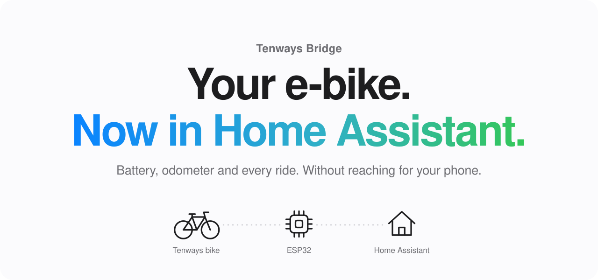
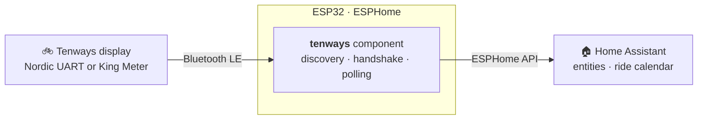

<p align="center">
  <picture>
    <source media="(prefers-color-scheme: dark)" srcset="docs/assets/hero-dark.svg">
    
  </picture>
</p>

<p align="center">
  <a href="https://github.com/stein155/tenways-bridge/actions/workflows/esphome.yml"></a>
  
  
  <a href="LICENSE"></a>
</p>

<p align="center">
  <a href="https://stein155.github.io/tenways-bridge/"><b>Web installer</b></a> ·
  <a href="#getting-started"><b>Getting started</b></a> ·
  <a href="#how-it-works"><b>How it works</b></a> ·
  <a href="#troubleshooting"><b>Troubleshooting</b></a> ·
  <a href="docs/protocols.md"><b>Protocols</b></a> ·
  <a href="CONTRIBUTING.md"><b>Contribute</b></a>
</p>

---

A Tenways bike only talks to its app, and only while your phone is next to it.

**Tenways Bridge listens all the time.** It is a small ESP32 near where the bike is parked. Switch the bike
on and the bridge connects by itself, with no pairing and no MAC address. Home Assistant gets the battery,
the odometer, the trip and the light, and every ride ends up in a calendar.

> [!NOTE]
> Unofficial community project, not affiliated with or endorsed by Tenways. Use at your own risk.

## Why Tenways Bridge

- **🔋 Know before you go.** The last known charge stays in Home Assistant after the bike
  is switched off, and after the bridge restarts.
- **🗓️ Every ride. Automatically.** Distance, duration, average speed and battery use land in a Home
  Assistant calendar, worked out from the odometer, so a ride counts even when the bridge missed the arrival.
- **🏠 Always home.** The bridge is always there, so the bike reports in whenever it is switched
  on at home, whoever rides it and wherever your phone is.
- **🚲 One bridge. Every bike.** Up to three bikes on one ESP32, each as its own Home Assistant device.

## The story

I own a Tenways CGO600 and run a smart home built around Home Assistant. I like to integrate as many devices
as possible into Home Assistant, including devices that do not expose a ready-made integration.

For this project I reverse engineered the bike's Bluetooth protocol and built an ESP32 bridge for it. In my
setup the ESP32 is mounted in the shed where the bike is parked. When the bike connects on departure or
arrival, the bridge reads the latest data and reports it to Home Assistant. The cargo bike next to it has a
different display, which became [B06 Bridge](https://github.com/stein155/b06-bridge); both bikes share the
same ESP32.

## What you get

| | |
| --- | --- |
| 🔋 **Battery** | Charge in percent, kept after the bike switches off. |
| 🛣️ **Odometer** | Total distance, as a `total_increasing` sensor for long-term statistics. |
| ⏱️ **Trip** | Speed, maximum and average speed, trip distance and trip duration. |
| 📏 **Range** | Remaining range, on displays that report it. |
| ⚡ **Power** | Motor power, on displays that report it. |
| 💡 **Light** | A switch that turns the bike's light on and off. |
| 🏷️ **Diagnostics** | Serial number, firmware version and the BLE status (`searching`, `connecting`, `handshake`, `connected`). |
| 🗓️ **Rides** | A [blueprint](homeassistant/blueprints/automation/tenways_rides.yaml) that writes every ride to a calendar. |

## Supported bikes

| Display | Status |
| --- | --- |
| **Tenways CGO600** | ✅ Tested |
| Tenways CGO600 Pro, PLUS, Pro-C, Pro_T | 🧪 Experimental |
| Tenways CGO800S, CGO800 Plus | 🧪 Experimental: connects, data unconfirmed |
| Tenways CGO009, Longtail Duo, AGO AIR, Wayfarer_B, CGO600_D, AGO, AGOX, AGOT, CARGO, CGO COMPACT_D, CGO001 | 🧪 Experimental |

Experimental displays get the requests the Tenways app uses, but have not been confirmed on a real bike.
Logs from your bike are welcome in [issue #2](https://github.com/stein155/tenways-bridge/issues/2).

## What you need

- An **ESP32** board with Bluetooth, such as an ESP32 DevKit (`esp32dev`), and a USB cable and charger for it.
  No wiring and nothing on the bike: the bridge only listens over Bluetooth.
- A spot for it within Bluetooth range of where the bike is parked, and in reach of your WiFi.
- [Home Assistant](https://www.home-assistant.io) with the ESPHome integration.

## Getting started

1. **Flash** an ESP32 from the browser with the [web installer](https://stein155.github.io/tenways-bridge/).
   Chrome or Edge, a USB cable, done.
2. **Connect** it to your WiFi when the installer asks. Skipped that? Join the *Tenways Bridge* hotspot and
   pick your network there.
3. **Add** the bridge in Home Assistant under *Settings → Devices & services*; it is discovered by itself.
4. **Switch the bike on** near the bridge. The BLE status goes to `connected` and the entities fill in.

Place the ESP32 near where the bike is parked. The installed firmware handles one bike
and finds it by name.

### Build it yourself

```yaml
external_components:
  - source:
      type: git
      url: https://github.com/stein155/tenways-bridge
      path: esphome/components
    components: [tenways]

tenways:
```

[`esphome/tenways-bridge.yaml`](esphome/tenways-bridge.yaml) is the complete configuration with all entities.

## How it works



- **Discovery without pairing.** The bridge connects to the first bike whose Bluetooth name matches. A bike
  it found that way is also recognised when it later advertises its Tenways service without a name.
- **Two transports.** The CGO600 family speaks Nordic UART; newer displays such as the CGO800 speak the King
  Meter protocol, with a model profile picked from the bike's name. Displays that need it get the encrypted
  session of the Tenways app. The [protocol reference](docs/protocols.md) has the details.
- **Built for short visits.** A bike is often in range for only a few seconds when you leave or come home.
  The bridge scans at its full window as long as any bike is still searching. Scanning stops only while a
  bike is being set up, from connecting until its first poll, because a scan next to it costs the connection,
  and once every bike is connected, so WiFi and Bluetooth share the radio well.

## Multiple bikes

Every bike gets its own `tenways` block and takes one of the ESP32's three BLE connections. Include
[`esphome/bike.yaml`](esphome/bike.yaml) once per bike to add it as a separate device in Home Assistant:

```yaml
packages:
  bike_1: !include
    file: bike.yaml
    vars:
      id: bike_1           # unique; also keys the bike's state in flash
      name: Bike 1         # device name in Home Assistant
      device_name: CGO600  # part of the bike's Bluetooth name
  bike_2: !include
    file: bike.yaml
    vars:
      id: bike_2
      name: Bike 2
      device_name: CGO800
```

A block only connects to a bike no other block holds.

## The bike bridges

Tenways Bridge is one of a family of ESPHome components that each speak one make of e-bike display, built
to share a single ESP32:

| Project | Bikes | |
| --- | --- | --- |
| **Tenways Bridge** (this repository) | Tenways CGO600, CGO800 and the other displays listed above | battery, odometer, trip, range, power, light, rides |
| [**B06 Bridge**](https://github.com/stein155/b06-bridge) | B06 displays of the BIKEGO plus app, such as on Bafang conversions | battery, odometer, trip, light |

A household with both kinds of bike needs one bridge, not two: add both `external_components` entries and
both blocks to the same configuration. The components ship the same `scan_coordinator.h`, through which they
share the radio: scanning keeps running until the bikes of both are connected, and stops while any of them
is being set up.

## Home Assistant

| Platform | Key | Unit |
| --- | --- | --- |
| `sensor` | `battery` | % |
| `sensor` | `speed`, `max_speed`, `avg_speed` | km/h |
| `sensor` | `trip_distance`, `remaining_range` | km |
| `sensor` | `odometer` | km (total increasing) |
| `sensor` | `trip_duration` | s |
| `sensor` | `power` | W |
| `text_sensor` | `serial_number`, `firmware_version`, `ble_status` | |
| `switch` | `light` | |

**Rides.** The [ride blueprint](homeassistant/blueprints/automation/tenways_rides.yaml) logs every ride of a bike
as an event in a calendar, such as a [local calendar](https://www.home-assistant.io/integrations/local_calendar/),
which keeps it permanently. It works from the odometer, not from the trip counters: a ride is counted even when the
bridge missed the arrival, and rides between two sightings of the bike count as one. Each ride has its start and
end, distance, duration, average speed and battery use; it also fires the `tenways_ride` event and can update a
text helper with the last ride. Per bike, create a text helper (maximum length 255) for the blueprint's state,
create an automation from the blueprint, and run it once. A calendar card in list view shows the rides.

**Distance per period.** The odometer is a `total_increasing` sensor, so Home Assistant keeps long-term
statistics for it. A bike can restart its odometer by itself; Home Assistant and the ride blueprint treat the
lower value as a new meter reading and count on from there. A statistics graph card shows the distance per day, week or month:

```yaml
type: statistics-graph
entities: [sensor.bike_1_odometer]
stat_types: [change]
period: week
chart_type: bar
```

## Troubleshooting

| BLE status | What it means | What to try |
| --- | --- | --- |
| stays `searching` | The bridge does not see the bike. | Switch the bike on near the bridge. Close the Tenways app: a display accepts one connection. Check that the bike's Bluetooth name contains one of `device_names`. |
| `connecting` or `handshake`, then back to `searching` | The bike is seen, but the connection does not hold. | Move the ESP32 closer to the bike, and away from metal and other 2.4 GHz devices. |
| `connected`, but entities stay empty | The display does not answer the requests. | Likely an experimental display; share the logs in [issue #2](https://github.com/stein155/tenways-bridge/issues/2). |

The logs tell the rest: `esphome logs <config> --device <bridge-ip>`, the ESPHome dashboard, or USB serial at
115200 baud. [SUPPORT.md](SUPPORT.md) lists what to include in a bug report.

## Upgrading from cgo600-bridge

Version 2 is a breaking release:

- The component is now `tenways` (was `cgo`); `cgo_id` is now `tenways_id`.
- `range` is now `odometer`. `web_ui`, `max_rides`, `on_ride` and the `esphome.cgo_ride` event are gone,
  together with the dashboard, the JSON API and the ride history on the bridge. Rides are derived in Home
  Assistant instead.
- The hostname changes from `cgo600-bridge-xxxxxx` to `tenways-bridge-xxxxxx`. Home Assistant keeps the device
  and its entity IDs; the bikes of the `bike.yaml` package appear as separate devices.
- WiFi credentials set through the installer or the hotspot are kept. A bridge whose credentials were
  compiled into its old firmware falls back to the *Tenways Bridge* hotspot after the update.

## For developers

| Where | What |
| --- | --- |
| [`esphome/components/tenways/`](esphome/components/tenways) | the component: BLE client, the two protocols, the encrypted session (C++) and its ESPHome schema (Python) |
| [`esphome/`](esphome) | the configuration the installer flashes, the per-bike package and the development configuration |
| [`homeassistant/blueprints/`](homeassistant/blueprints) | the ride blueprint |
| [`installer/`](installer) | the web installer page and the scripts that publish it |
| [`tests/`](tests) | host tests of the protocol code: frames, parsing, encryption |
| [`docs/`](docs) | the [protocol reference](docs/protocols.md) |

You do not need a bike to work on the protocol code; the host tests run on any machine with a C++17 compiler
and mbedtls:

```bash
tests/run.sh                          # host tests of the protocol code
./lint.sh                             # clang-format, ruff, yamllint, shellcheck (requirements-lint.txt)
esphome compile esphome/dev.yaml      # two bikes; copy esphome/secrets.yaml.example first
esphome logs esphome/dev.yaml --device <bridge-ip>
```

CI runs the linters and the host tests, and compiles `esphome/dev.yaml` and the installer configuration.
Only the protocol code has automated tests; everything else is verified on a real bike. Start with
[CONTRIBUTING.md](CONTRIBUTING.md); releases follow [RELEASE.md](RELEASE.md).

## Thanks

Tenways Bridge is built on [ESPHome](https://esphome.io) and [Home Assistant](https://www.home-assistant.io),
and the installer on [ESP Web Tools](https://esphome.github.io/esp-web-tools/). The King Meter framing of the
Longtail Duo was first documented by [tenways-ble](https://github.com/Styx85/tenways-ble).

## Legal

Tenways Bridge is licensed under the [MIT License](LICENSE).

It is an independent project, **not affiliated with, endorsed by or sponsored by Tenways**. *Tenways* and the
model names are trademarks of their owner, used only to identify the bikes the bridge works with. Use it at
your own risk.
