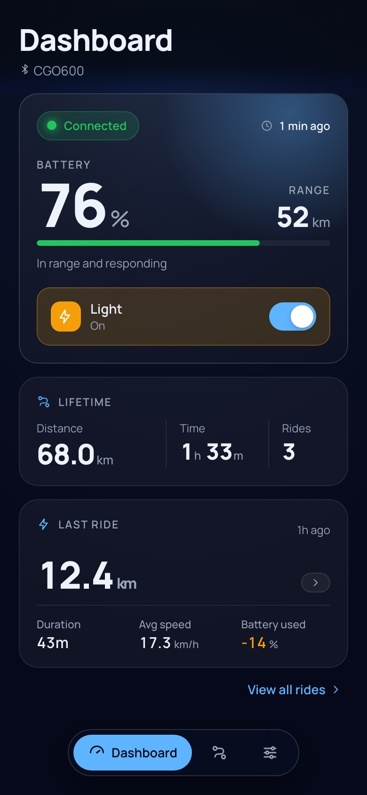
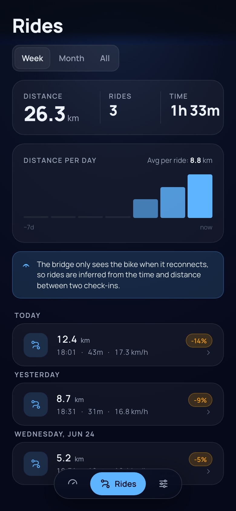
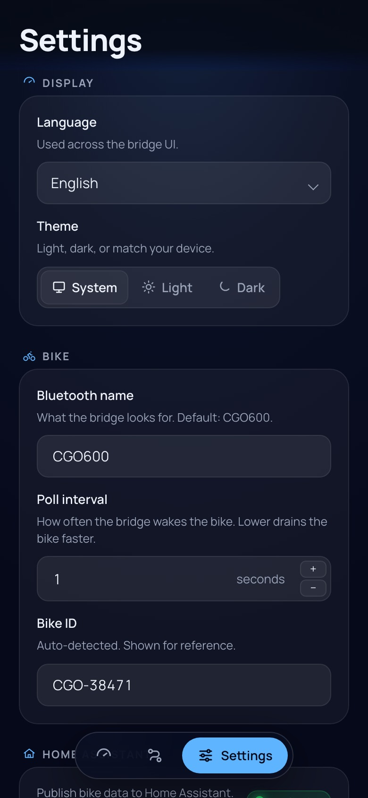

# CGO600 Smart Bridge

Standalone ESP32 firmware that reads live telemetry from a **Tenways CGO600** e-bike over Bluetooth Low Energy and forwards it to **Home Assistant** via MQTT. Includes a built-in, multilingual web dashboard (installable as a PWA) for live monitoring, light control, and a local ride history — no computer needed after initial setup.

> "TENWAYS" and "CGO600" are trademarks of TENWAYS. This is an unofficial community project, not affiliated with or endorsed by TENWAYS — use at your own risk.

## Motivation

I own a Tenways CGO600 and run a smart home built around Home Assistant. I like to integrate as many devices as possible into Home Assistant, including devices that do not expose a ready-made integration.

For this project I reverse engineered the bike's Bluetooth protocol and built ESP32 firmware that acts as a small BLE-to-MQTT gateway. In my setup the ESP32 is mounted in the shed where the bike is parked. When the bike connects on departure or arrival, the gateway reads the latest data and publishes it to Home Assistant via MQTT.

## Screenshots

| Dashboard | Rides | Configuration |
|---|---|---|
|  |  |  |

## Home Assistant entities

| Sensor | Unit | MQTT topic |
|---|---|---|
| Battery | % | `cgo600/sensor/battery/state` |
| Speed | km/h | `cgo600/sensor/speed/state` |
| Max speed | km/h | `cgo600/sensor/max_speed/state` |
| Average speed | km/h | `cgo600/sensor/avg_speed/state` |
| Trip distance | km | `cgo600/sensor/trip_distance/state` |
| Trip duration | s | `cgo600/sensor/trip_duration/state` |
| Remaining range | km | `cgo600/sensor/remaining_range/state` |
| Total range | km | `cgo600/sensor/range/state` |
| Serial number | — | `cgo600/sensor/serial_number/state` |
| Last connected | ISO 8601 UTC | `cgo600/sensor/last_connected/state` |
| Light | on/off | `cgo600/light/state` |

The light can also be controlled from Home Assistant by publishing `on` or `off` to `cgo600/light/set`.

All entities are registered in Home Assistant automatically via MQTT discovery. The topic prefix (`cgo600`) is configurable.

## Ride history

The bridge only sees the bike when it reconnects (typically on departure or arrival), so it infers rides from the time and distance between two check-ins. Each inferred ride records its window, distance, duration, battery delta, and average/max speed. Rides are stored locally on the ESP32 and shown on the dashboard's Rides tab.

---

## Requirements

- ESP32 dev board — recommended: **ESP32-WROOM-32U** (external antenna connector for better BLE range). This is what the project runs on in practice; other ESP32 boards will work but WROOM-32U is the tested configuration.
- USB cable for initial flashing

---

## Installation

### Pre-built firmware

Download the four `.bin` files from the [latest release](../../releases/latest) and flash with [esptool](https://docs.espressif.com/projects/esptool/en/latest/):

```bash
esptool.py --chip esp32 --baud 460800 \
  write_flash \
  0x1000   cgo600-bootloader.bin \
  0x8000   cgo600-partitions.bin \
  0x10000  cgo600-firmware.bin \
  0x3D0000 cgo600-littlefs.bin
```

### Build from source

Install [PlatformIO](https://platformio.org/install/cli), then from the repo root:

```bash
pio run -d firmware -t upload
pio run -d firmware -t uploadfs
```

Add `--upload-port <port>` if auto-detection fails:

```bash
pio run -d firmware -t upload --upload-port <port>
```

---

## First setup

1. After flashing, the ESP32 creates a WiFi access point called **CGO600-Setup**.
2. Connect your phone or laptop to that network.
3. A captive portal opens — select your WiFi and enter the password.
4. The device connects to your network and is usually reachable at **http://cgo600.local/** on networks that support mDNS. Otherwise, use the ESP32 IP address shown by your router.

---

## Updating

After initial USB flashing, updates can be done over WiFi. Use `cgo600.local` when mDNS works, or the ESP32 IP address otherwise:

```bash
pio run -d firmware -t upload --upload-port cgo600.local
```

If you changed the web interface:

```bash
pio run -d firmware -t buildfs
pio run -d firmware -t uploadfs --upload-port cgo600.local
```

---

## BLE protocol

The CGO600 exposes a Nordic UART Service (NUS) over BLE. Commands are written to the RX characteristic; telemetry replies arrive as notifications on the TX characteristic. The protocol details below come from reverse engineering and may differ across bike/display firmware versions.

### Frame format

```
Read  0x52 [len] [field_ids...] [CRC16_lo] [CRC16_hi] 0x45
Write 0x57 [len] [payload...]   [CRC16_lo] [CRC16_hi] 0x45
```

CRC16 is computed over all bytes from the start byte up to (but not including) the CRC bytes, using the same lookup table as the Python reference implementation.

### Field IDs

| ID | Field | Decoding |
|---|---|---|
| `0x07` | Serial number | ASCII string |
| `0x11` | Speed | uint16 BE ÷ 10 → km/h |
| `0x12` | Max speed | uint16 BE ÷ 10 → km/h |
| `0x13` | Average speed | uint16 BE ÷ 10 → km/h |
| `0x14` | Trip distance | uint16 BE ÷ 10 → km |
| `0x15` | Trip duration | uint16 BE → seconds |
| `0x16` | Remaining range | uint16 BE ÷ 10 → km |
| `0x17` | Total range | uint16 BE ÷ 10 → km |
| `0x1A` | Battery | uint8 → % |
| `0x21` | Light | uint8 (0 = off, 1 = on) |

---

## Repository layout

```
firmware/
  platformio.ini        Build configuration
  partitions.csv        Custom partition layout
  src/
    main.cpp            WiFi, mDNS, OTA, orchestration
    config.h/.cpp       Persistent configuration (NVS)
    protocol.h/.cpp     Frame building, parsing, CRC16
    bike_state.h/.cpp   Telemetry data model and field decoding
    ble_client.h/.cpp   BLE scan, connect, handshake, polling
    mqtt_ha.h/.cpp      MQTT publishing and Home Assistant discovery
    ride_log.h/.cpp     Ride inference and local history storage
    web_server.h/.cpp   HTTP API and web interface serving
    logger.h/.cpp       Logging helpers
    reset_reason.h      Boot/reset reason decoding
  scripts/
    build_web.py        Bundles web/ into data/ (runs automatically on every build)
  web/                  Web UI sources (single-page app, no framework)
    index.html          Dashboard shell
    js/                 App modules, bundled into app.js in a fixed order
      views/            Dashboard, rides, ride detail, settings, tab bar
    css/                Styles, bundled into style.css in filename order
    i18n.js             UI translations and theme handling
    config.html         Redirect shim (/config.html → /#settings)
    manifest.json       PWA manifest
    sw.js               Service worker (offline shell cache)
  data/                 Generated, gzipped LittleFS content (git-ignored)
```

### Partition layout

| Partition | Size | Purpose |
|---|---|---|
| app0 | 1.9 MB | Firmware (active) |
| app1 | 1.9 MB | Firmware (OTA staging) |
| spiffs | 192 KB | Web interface (LittleFS) |
| nvs | 20 KB | Configuration storage |

The partition label is `spiffs` for ESP32 compatibility, but PlatformIO builds a LittleFS image for it.

### Web UI development

Edit the sources in `firmware/web/`, never `firmware/data/`: that directory is regenerated from `web/` on every PlatformIO build. Every file is stored gzipped; the web server serves `<name>.gz` for `<name>`. A new JS file must be added to `JS_ORDER` in `firmware/scripts/build_web.py`; CSS files are bundled in filename order. To build the bundle without PlatformIO, run `python3 firmware/scripts/build_web.py`.

> **Note:** `uploadfs` replaces the whole LittleFS partition, which also holds the ride history. Flashing the web UI therefore clears the stored rides.
